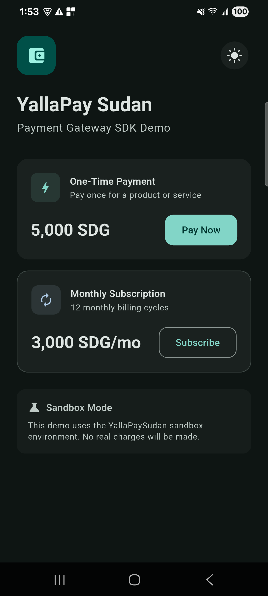
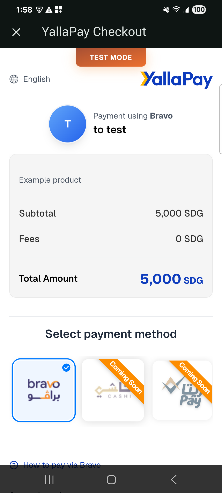
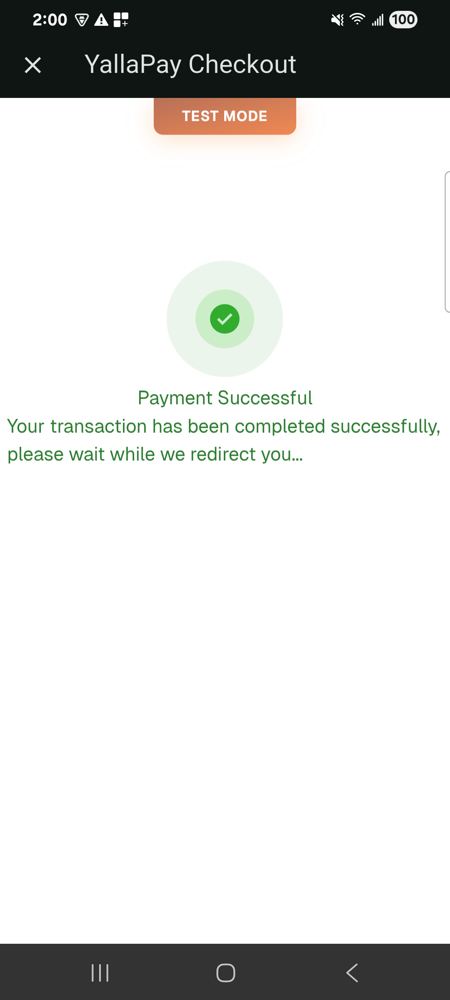
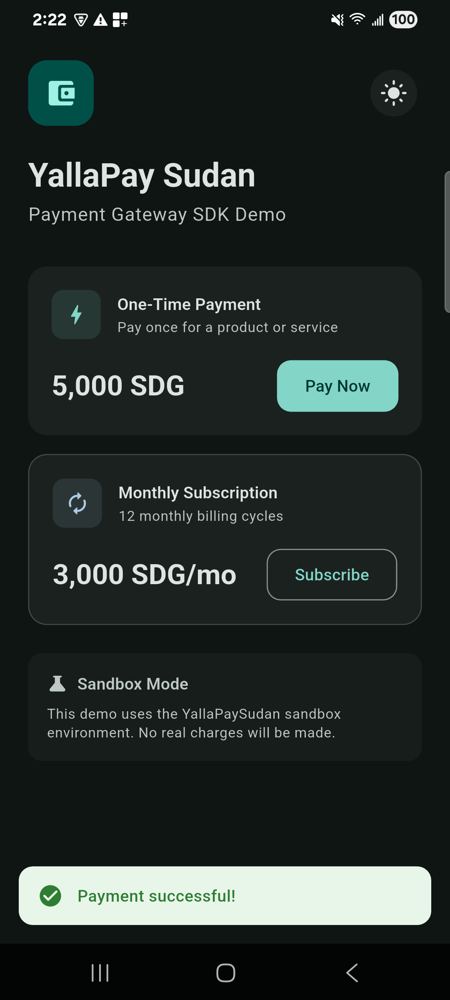

# YallaPay Sudan for Dart and Flutter

Dart and Flutter packages for the [YallaPaySudan](https://yallapaysudan.com) payment gateway.

| Package | Where it runs | What it does |
| --- | --- | --- |
| [`yalla_pay_sudan_core`](packages/yalla_pay_sudan_core) | Your **server** (pure Dart, no Flutter) | Creates payment and subscription links, checks payment status, verifies webhook signatures. Holds the API key and webhook secret. |
| [`yalla_pay_sudan`](packages/yalla_pay_sudan) | Your **Flutter app** | Opens the checkout in an in-app WebView and returns a typed result. Holds no secrets. |

> **Keep secrets on the server.** The YallaPaySudan auth token (`sk_...` / `test_sk_...`) and the webhook secret must never be bundled into a mobile or web app: anyone can extract them from an APK or IPA. The app asks your backend for a checkout URL; the backend calls the gateway with `yalla_pay_sudan_core`.

## Screenshots

| Main Screen | Checkout | Payment Success | Result |
| :-: | :-: | :-: | :-: |
|  |  |  |  |

## Development

The Flutter package depends on `yalla_pay_sudan_core` from pub.dev. To work on both together, point it at the local checkout:

```bash
bash tool/dev_overrides.sh          # writes git-ignored pubspec_overrides.yaml files
(cd packages/yalla_pay_sudan_core && dart pub get && dart test)
(cd packages/yalla_pay_sudan && flutter pub get && flutter test)
bash tool/dev_overrides.sh --remove # before publishing
```

CI (`.github/workflows/ci.yml`) checks formatting, analysis and tests for both packages, checks that core resolves and passes its tests with the plain Dart SDK, and runs [pana](https://pub.dev/packages/pana) on both packages; anything under 160/160 fails.

## Releasing

Publish `yalla_pay_sudan_core` first, then `yalla_pay_sudan`. Pushing a tag `yalla_pay_sudan_core-v<version>` or `yalla_pay_sudan-v<version>` publishes that package through pub.dev automated publishing (see `.github/workflows/publish.yml`).

## License

MIT
