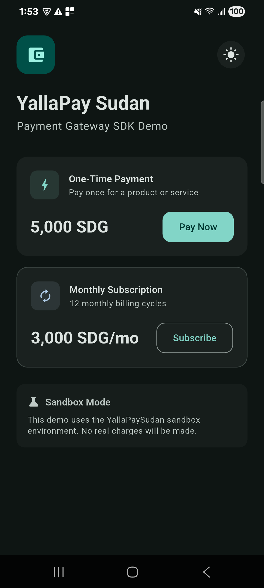
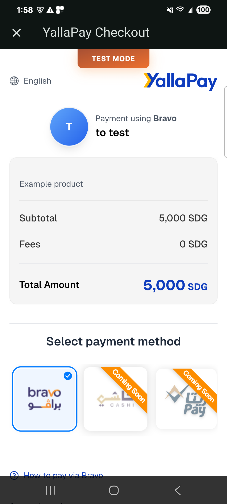
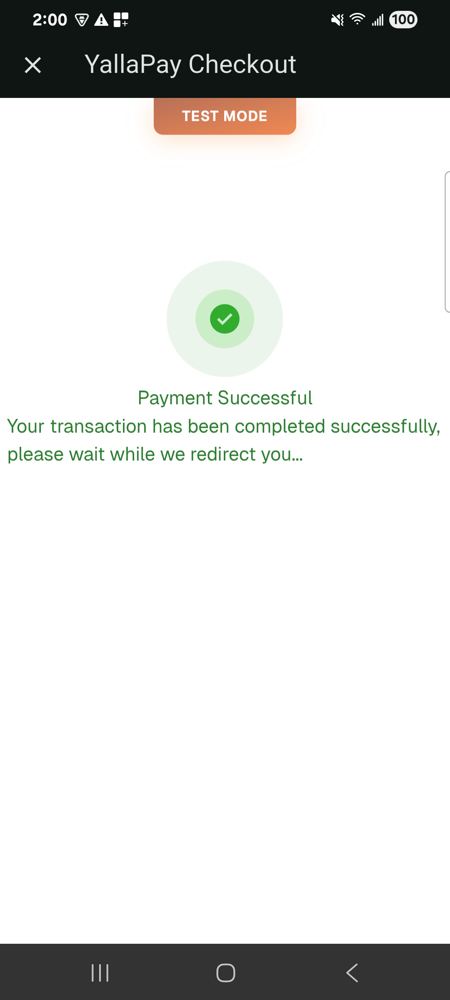
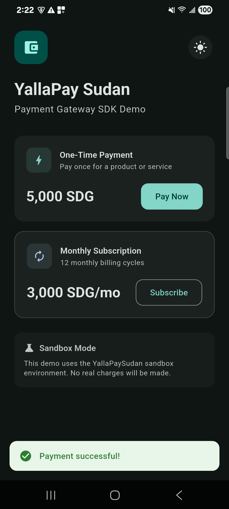

# yalla_pay_sudan

In-app checkout for the [YallaPaySudan](https://yallapaysudan.com) payment gateway. Your backend creates the payment; this package opens the hosted checkout in a WebView inside your app and tells you how it ended.

> [!IMPORTANT]
> **Version 2 moves payment creation to your server.** Creating a payment needs the merchant auth token (`sk_...`), and anything shipped in an app can be extracted from it. Create payments on your backend with the pure Dart [`yalla_pay_sudan_core`](https://pub.dev/packages/yalla_pay_sudan_core) package, and send the app only the checkout URL and redirect URLs. If you used 1.x, see [Migrating from 1.x](#migrating-from-1x).

## Screenshots

| Main Screen | Checkout | Payment Success | Result |
| :-: | :-: | :-: | :-: |
|  |  |  |  |

## How it works

1. The app asks **your backend** to start a checkout.
2. The backend calls `createPayment` with `yalla_pay_sudan_core`, keeping the token on the server, and returns `paymentUrl`, `successUrl` and `failedUrl`.
3. The app opens the checkout with `YallaPayCheckoutWebView.show`.
4. The gateway sends a signed webhook to your backend, which marks the order paid.
5. The app asks your backend for the order status.

The WebView's result is a hint for the UI, **not proof of payment**. It only knows which redirect URL the page navigated to, and anything running in the page could navigate there. Fulfil orders from what your server has verified.

## Install

```bash
flutter pub add yalla_pay_sudan
```

Supported platforms: Android, iOS and macOS (through [`webview_flutter`](https://pub.dev/packages/webview_flutter)). Flutter 3.44 or newer.

- **Android:** the app needs `<uses-permission android:name="android.permission.INTERNET"/>` in `android/app/src/main/AndroidManifest.xml`. Flutter only adds it to debug builds.
- **macOS:** add `com.apple.security.network.client` to `macos/Runner/DebugProfile.entitlements` and `Release.entitlements`. Without it the sandbox blocks the checkout page.
- **iOS:** nothing extra.

## Open the checkout

```dart
final result = await YallaPayCheckoutWebView.show(
  context,
  paymentUrl: session.paymentUrl,
  successUrl: session.successUrl,
  failedUrl: session.failedUrl,
);

if (result.isSuccessful) {
  // Say "confirming your payment", then ask your backend for the order.
} else if (result.isFailed) {
  // Offer to try again.
} else {
  // Closed by the customer. It may still have been paid: ask your backend.
}
```

`session` is whatever your backend returned. `successUrl` and `failedUrl` must be the `paymentSuccessfulRedirectUrl` and `paymentFailedRedirectUrl` the payment was created with. `show` returns `PaymentStatus.cancelled` when the customer closes the page or goes back.

### What the WebView allows

- **Redirect detection** matches scheme, host, port and path exactly. The gateway may add query parameters, but a page that merely *contains* your success URL (for example `https://evil.example/?next=https://shop.example/success`) doesn't count.
- **Top-level pages** must be `https` on the gateway's domain (`yallapaysudan.com` and its subdomains). Anything else (other hosts, plain `http`, `intent:`, `tel:`, banking-app links) is blocked and passed to `onNavigationBlocked`.
- **Embedded frames** may load `https` content (payment widgets, captchas) but never end the checkout.
- **JavaScript** is enabled because the hosted page needs it. No JavaScript channels are added, so the page can't call into your app.
- The checkout's end is also detected from `onPageStarted` and `onUrlChange`, because some redirects (such as after a form POST on Android) skip the navigation callback.
- Failed images or scripts don't replace the page with an error. Only a failure of the page itself shows the error view with **Try again**.

If the payment flow needs another host, for example a bank's 3-D Secure page, allow it explicitly:

```dart
final result = await YallaPayCheckoutWebView.show(
  context,
  paymentUrl: session.paymentUrl,
  successUrl: session.successUrl,
  failedUrl: session.failedUrl,
  allowedHosts: [
    ...YallaPayCheckoutWebView.defaultAllowedHosts,
    'secure.your-bank.example',
  ],
  onNavigationBlocked: (uri) => debugPrint('Blocked navigation to $uri'),
);
```

### Embed it yourself

```dart
return Scaffold(
  appBar: AppBar(title: const Text('Checkout')),
  body: YallaPayCheckoutWebView(
    paymentUrl: session.paymentUrl,
    successUrl: session.successUrl,
    failedUrl: session.failedUrl,
    onCheckoutResult: (result) => Navigator.of(context).pop(result),
    loadingWidget: const Center(child: Text('Loading checkout...')),
    errorBuilder: (context, message, retry) => Center(
      child: TextButton(onPressed: retry, child: Text('Retry ($message)')),
    ),
  ),
);
```

## Example

[`example/`](example) is a full app, and [`example/server/`](example/server) is the small Shelf backend it talks to, which holds the secrets. See [`example/server/README.md`](example/server/README.md) to run both.

## Migrating from 1.x

- **`YallaPayClient`, `YallaPayConfig`, the request models, exceptions and `WebhookVerifier`** moved to [`yalla_pay_sudan_core`](https://pub.dev/packages/yalla_pay_sudan_core). Use them on your server and remove the token from your app.
- **`successUrlPattern` / `failedUrlPattern`** are now `successUrl` / `failedUrl`, they're required, and they match exactly instead of by substring.
- **`show` returns `Future<CheckoutResult>`**, never `null`: closing the page gives `PaymentStatus.cancelled`. Without redirect URLs it throws `ArgumentError` instead of crashing.
- **`errorWidgetBuilder(String)`** is now `errorBuilder(context, message, retry)`.
- **`PaymentStatus.unknown`** is new, so exhaustive `switch` statements need a case for it.
- **Flutter 3.44 or newer** is required. The package uses `package:material_ui`, which replaces the deprecated `package:flutter/material.dart` in Flutter 3.50.

## License

MIT
